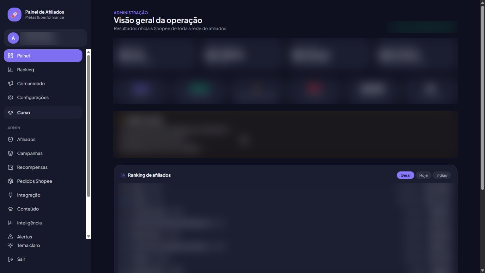
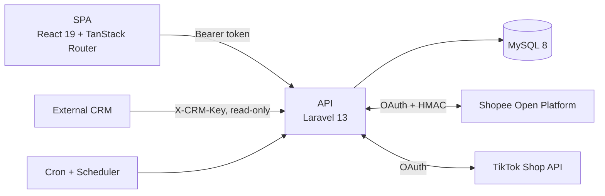

<h1 align="center">VYTACore Affiliate Dashboard</h1>

Affiliate gamification platform integrated with the official Shopee and TikTok Shop APIs — in production

     

<a href="https://afiliadosvytacore.com"><b>Live site</b></a>

 Admin overview — real sales and affiliate data blurred.

> **Note:** the source code is private (production systems). This repository is a technical overview: what it does, how it is built and what it looks like. Happy to walk through the code in an interview — reach me on [LinkedIn](https://www.linkedin.com/in/guilherme-vytacore/).

## Overview

A production system that turns affiliate sales into points, levels, rankings and rewards for the brand's Shopee affiliate network. Core rule: a manual entry never generates points or money. A sale must be confirmed by the marketplace's official API, validated by the backend, deemed eligible by the campaign, approved by an admin and recorded in an audit trail before any payout.

## Highlights

- **Shopee Open Platform integration**: shop OAuth, HMAC-SHA256 request signing and the affiliate conversion report (AMS)
- **TikTok Shop integration**: orders per creator through the Affiliate Seller API
- **Automatic sync every 30 minutes** with the Laravel Scheduler
- **Rankings, levels, campaigns and rewards** with admin approval, fraud alerts and audit log
- **Read-only API for an external CRM**: key-protected, paginated, incremental pull
- **Token auth** (Sanctum), roles and account status, strict per-affiliate data isolation
- **Full technical documentation** (14 sections) for handover and maintenance

## Architecture

## Tech stack

- **Backend:** PHP 8.4, Laravel 13, Sanctum, MySQL 8, PHPUnit, Pint
- **Frontend:** React 19, TanStack Router, Vite, Tailwind CSS v4, shadcn/ui, Vitest
- **Infrastructure:** Docker (development), Hostinger, cron + Laravel Scheduler

---

<b>Versão em português</b>

> **Observação:** o código-fonte é privado (sistemas em produção). Este repositório é uma visão técnica do projeto. Posso apresentar o código em uma entrevista — fale comigo pelo [LinkedIn](https://www.linkedin.com/in/guilherme-vytacore/).

## Visão geral

Sistema em produção que transforma as vendas da rede de afiliados Shopee da marca em pontos, níveis, ranking e recompensas. Regra central: registro manual nunca gera ponto nem dinheiro. A venda precisa ser confirmada pela API oficial, validada pelo backend, considerada elegível pela campanha, aprovada por um administrador e registrada em auditoria.

## Destaques

- **Shopee Open Platform**: OAuth da loja, assinatura HMAC-SHA256 e relatório de conversões (AMS)
- **TikTok Shop**: pedidos por criador pela API de afiliados
- **Sincronização automática a cada 30 minutos** com o Laravel Scheduler
- **Ranking, níveis, campanhas e recompensas** com aprovação, alertas de fraude e auditoria
- **API somente leitura para CRM externo**, paginada e incremental
- **Autenticação por token** (Sanctum) e isolamento de dados por afiliado
- **Documentação técnica completa** (14 seções)

## Stack

- **Backend:** PHP 8.4, Laravel 13, Sanctum, MySQL 8, PHPUnit, Pint
- **Frontend:** React 19, TanStack Router, Vite, Tailwind CSS v4, shadcn/ui, Vitest
- **Infra:** Docker (desenvolvimento), Hostinger, cron + Laravel Scheduler

